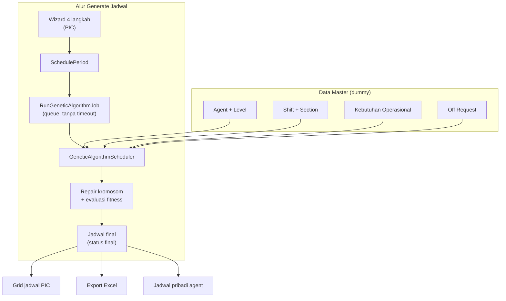
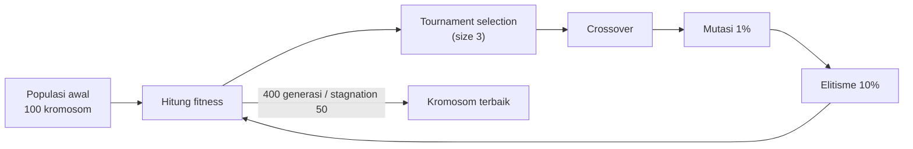

# XYZ Scheduling — Penjadwalan Shift dengan Algoritma Genetika

[](https://github.com/GalihArfn01/GA_Shift_Scheduler/actions/workflows/tests.yml)


> Sistem penjadwalan shift mingguan untuk contact center yang menyusun jadwal otomatis
> dengan **Algoritma Genetika (GA)**. Jadwal dibuat dengan mempertimbangkan level
> kompetensi agent, kebutuhan operasional per section, permintaan off, dan batas istirahat
> antar shift. Seluruh data yang dikirim adalah **data dummy**.

---

## Masalah yang Diselesaikan

Menjadwalkan puluhan agent ke 7 hari × beberapa section/shift secara manual itu lambat
dan rawan konflik: agent bisa dobel booking, level kompetensi tidak sesuai section, atau
off request terlewat. Aplikasi ini menggantikan proses tersebut dengan:

- **Hard constraint** yang dijamin tidak dilanggar (validitas jadwal).
- **Soft constraint** yang dioptimasi lewat fungsi fitness (kualitas jadwal).
- Proses **asynchronous** lewat queue, sehingga generate jadwal tidak mem-blok UI.
- Review dan ekspor ke format Excel yang biasa dipakai operasional.

---

## Fitur Utama

**Role PIC (Supervisor)**
- Kelola data agent (level 1–3, status aktif/skorsing) dan akun login.
- Kelola template operasional (pola kebutuhan shift per section/hari).
- Kelola off request: Form Request (kuota 3/hari/kelompok), Prioritas Tinggi, input manual PIC.
- Wizard generate 4 langkah: buat periode → isi kebutuhan → generate & review → buka Form Request.
- Persetujuan tukar jadwal antar agent (dengan pengecekan konflik).
- History & rekapitulasi bulanan, ekspor Excel, dan benchmark parameter GA.

**Role Agent**
- Lihat jadwal pribadi dan jadwal tim per periode.
- Ajukan Form Request dan Off Request Prioritas Tinggi.
- Ajukan & tanggapi permintaan tukar jadwal.
- Notifikasi status persetujuan.

---

## Arsitektur





---

## Algoritma Genetika

Implementasi inti ada di [`app/Services/GeneticAlgorithmScheduler.php`](app/Services/GeneticAlgorithmScheduler.php).

| Komponen | Nilai / Pendekatan |
|---|---|
| Encoding | *Slot-centric*: tiap slot kebutuhan (hari × section × shift) berisi satu agent |
| Populasi | 100 kromosom |
| Generasi maksimal | 400 (early stop setelah 50 generasi tanpa perbaikan) |
| Selection | Tournament, ukuran 3 |
| Crossover | Slot-centric dengan repair |
| Mutation rate | 1% |
| Elitism | 10% |
| Fitness | `1 / (1 + total_penalty)` |

**Hard constraint** (wajib dipenuhi): HC1 semua slot terisi, HC2/HC5 tanpa dobel booking
dan satu shift per hari, HC3 level sesuai section, HC4 hanya agent aktif, HC6 shift `A7`/`A`
hanya di Chat.

**Soft constraint** (diooptimasi): SC1 off request prioritas tinggi (100), SC2 off request
rendah (20), SC3 maksimal 5 hari kerja (30), SC4 pemerataan beban (10), SC5 istirahat min.
11 jam (5), SC6 pemerataan inbound (8).

Detail lengkap ada di [`docs/constraints-ga.md`](docs/constraints-ga.md).

Parameter bisa di-tuning dan dibandingkan tanpa menyimpan jadwal:

```bash
php artisan ga:benchmark 1 --runs=3 \
  --configs='[{"label":"baseline","params":{"population_size":100,"max_generations":400}}]'
```

Hasil benchmark ditulis sebagai JSONL di `storage/logs/`.

---

## Hasil Evaluasi

Pengujian dilakukan pada satu periode contoh berisi **134 slot kebutuhan**, dengan
**13 kombinasi parameter × 5 run = 65 eksekusi**. Seluruh run berhasil mengisi
134/134 slot (`unfilled = 0`), sehingga hard constraint HC1 terpenuhi.
Data mentah: [`docs/hasil-pengujian-ga.xlsx`](docs/hasil-pengujian-ga.xlsx).

**Pengaruh ukuran populasi** (generasi 200, mutasi 0.02)

| Populasi | Rata-rata fitness | Rata-rata penalty | Rata-rata durasi | Best fitness |
|---:|---:|---:|---:|---:|
| 20 | 0.024165 | 52.52 | 21.8 dtk | 0.044029 |
| 50 | 0.024559 | 45.84 | 54.7 dtk | 0.044664 |
| **100** | **0.032909** | **32.89** | 110.4 dtk | **0.047689** |
| 200 | 0.031558 | 36.28 | 233.4 dtk | 0.047414 |

**Pengaruh generasi maksimal** (populasi 100, mutasi 0.02)

| Generasi | Rata-rata fitness | Rata-rata penalty | Rata-rata durasi | Best fitness |
|---:|---:|---:|---:|---:|
| 50 | 0.017535 | 57.96 | 33.0 dtk | 0.021869 |
| 100 | 0.020126 | 50.74 | 60.3 dtk | 0.023596 |
| 200 | 0.025211 | 44.42 | 106.8 dtk | 0.044682 |
| 400 | **0.030168** | 36.80 | 145.8 dtk | 0.043351 |

**Pengaruh mutation rate** (populasi 100, generasi 400)

| Mutation rate | Rata-rata fitness | Rata-rata penalty | Rata-rata durasi | Best fitness |
|---:|---:|---:|---:|---:|
| 0.005 | 0.016206 | 60.73 | 105.7 dtk | 0.016823 |
| **0.01** | **0.033317** | **32.34** | 119.0 dtk | **0.047533** |
| 0.02 | 0.027978 | 36.49 | 149.1 dtk | 0.042138 |
| 0.05 | 0.025590 | 39.66 | 178.6 dtk | 0.037160 |
| 0.10 | 0.019304 | 59.22 | 191.3 dtk | 0.031467 |

**Kesimpulan**

- Fitness terbaik keseluruhan: **0.047689** (total penalty 19.97) dari konfigurasi populasi 100.
- Rata-rata fitness tertinggi: **0.033317** pada mutasi `0.01` — sesuai nilai default implementasi.
- Populasi **100** merupakan titik seimbang: lebih baik dari 20/50, hampir setara 200, tetapi durasinya sekitar setengahnya.
- Generasi **400** memberi rata-rata terbaik, namun generasi 200 sudah mencapai best fitness `0.044682` dengan waktu lebih singkat — menjadi dasar early stopping `stagnationLimit = 50`.

---

## Teknologi

- Laravel 12 / PHP 8.2
- SQLite (demo & test), MySQL didukung lewat `.env`
- Blade + Tailwind CSS 4 + Alpine.js (Vite)
- PhpSpreadsheet untuk ekspor Excel
- Queue worker untuk job GA
- Pest untuk testing

---

## Instalasi & Demo

Semua akun dan data adalah **dummy** — aman untuk dipakai siapa pun.

```bash
composer install
cp .env.example .env
php artisan key:generate

# SQLite (sesuai .env.example)
touch database/database.sqlite

php artisan migrate --seed
npm install && npm run build
php artisan serve
```

Pada Windows PowerShell, ganti perintah `touch` dengan:

```powershell
New-Item -ItemType File database/database.sqlite -Force
```

Jalankan queue worker di terminal terpisah agar generate jadwal diproses:

```bash
php artisan queue:listen --tries=1 --timeout=0
```

Atau jalankan semuanya sekaligus dengan `composer dev`.

**Akun demo**

| Role | Email | Password |
|---|---|---|
| PIC / Supervisor | `supervisor@ptxyz.local` | `password123` |
| Agent | `agent.01@ptxyz.local` | `password123` |

Seeder tambahan untuk data jadwal, kebutuhan operasional, dan off request:

```bash
php artisan db:seed --class=OperationalTemplate17AgustusSeeder
php artisan db:seed --class=Schedule1AgustusSeeder
php artisan db:seed --class=Schedule3AgustusSeeder
php artisan db:seed --class=Schedule10AgustusSeeder
php artisan db:seed --class=Schedule17AgustusSeeder
php artisan db:seed --class=Schedule27AgustusSeeder
php artisan db:seed --class=OperationalRequirementDemoSeeder
php artisan db:seed --class=OffRequestTinggiSeeder
php artisan db:seed --class=OffRequestRendahSeeder
```

---

## Pengujian

```bash
php artisan test
```

Coverage saat ini mencakup:

- Tidak ada double-booking; hanya agent aktif yang ditugaskan.
- HC3 (level sesuai section) dan HC6 (shift A7/A hanya di Chat).
- Off request prioritas tinggi membuat agent tidak eligible.
- Hanya off request berstatus `diterima` yang dipertimbangkan.
- `repairChromosome()` menghapus double-booking.
- Otorisasi dan validasi konflik pada tukar jadwal.

Badge **Tests** di atas menampilkan status workflow CI di
`.github/workflows/tests.yml`, yang berjalan otomatis tiap push.

---

## Struktur Penting

| Path | Isi |
|---|---|
| `app/Services/GeneticAlgorithmScheduler.php` | Inti algoritma genetika & constraint |
| `app/Services/GeneticAlgorithmJobRunner.php` | Orkestrasi job + status |
| `app/Jobs/RunGeneticAlgorithmJob.php` | Job queue GA |
| `app/Console/Commands/GaBenchmark.php` | Benchmark parameter GA |
| `app/Services/ScheduleExcelExporter.php` | Ekspor jadwal ke Excel |
| `database/seeders/` | Seluruh data dummy (agent, jadwal, kebutuhan, off request) |
| `resources/views/schedules/` | Wizard generate jadwal |
| `resources/views/pic/schedule-grid/` | Grid & edit jadwal PIC |
| `docs/constraints-ga.md` | Dokumentasi constraint & fitness |
| `docs/hasil-pengujian-ga.xlsx` | Data mentah 65 run benchmark GA |

---

## Keterbatasan & Pengembangan Lanjutan

- Proses GA berjalan di queue worker; progres hanya dipantau lewat polling status job, belum ada push notification real-time.
- Level "Training" (HC8) sudah didukung model dan constraint, tetapi belum dipakai dalam data dummy.
- Visualisasi konvergensi fitness belum otomatis; saat ini hasil benchmark berupa JSONL dan tabel ringkasan.
- Ekspor Excel memakai template 32 baris; baris untuk agent tambahan dibuat otomatis dengan meniru gaya baris terakhir.
- Pendaftaran akun sengaja dinonaktifkan; akun dibuat oleh PIC lewat seeder/menu kelola agent.

---

## Lisensi

MIT — lihat [`LICENSE`](LICENSE).
